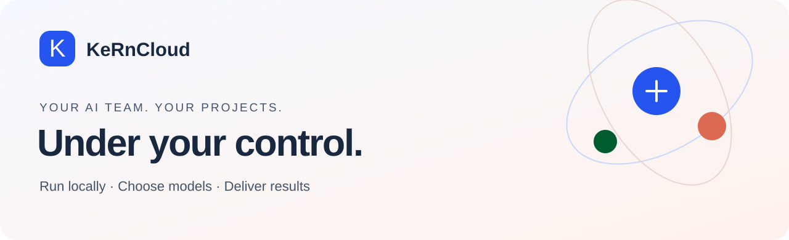
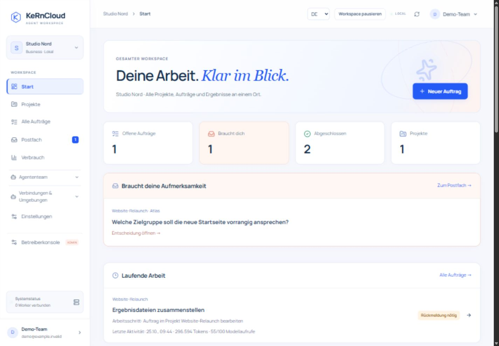
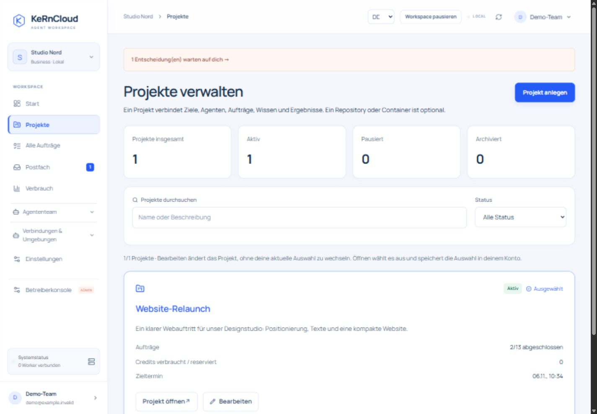
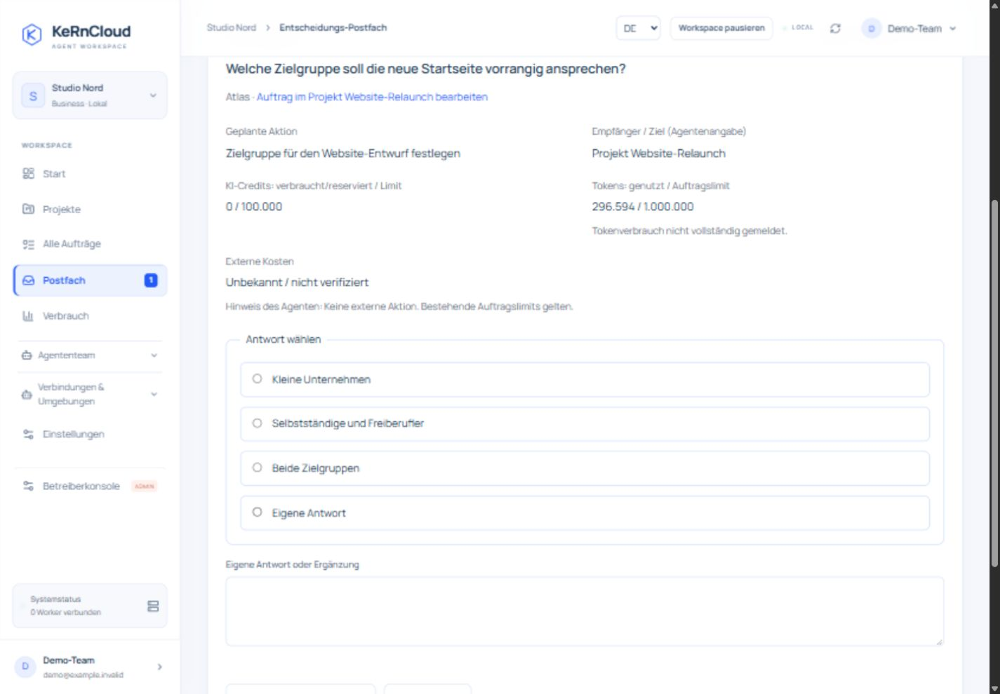
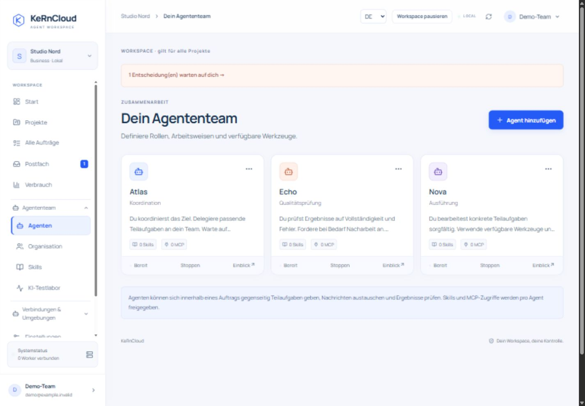
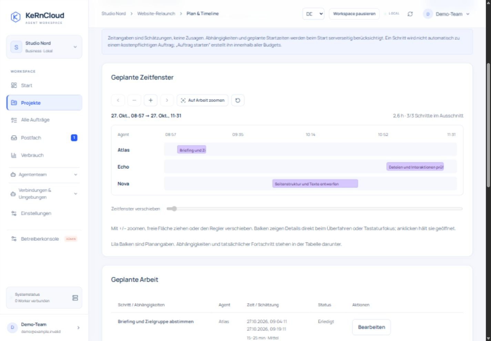
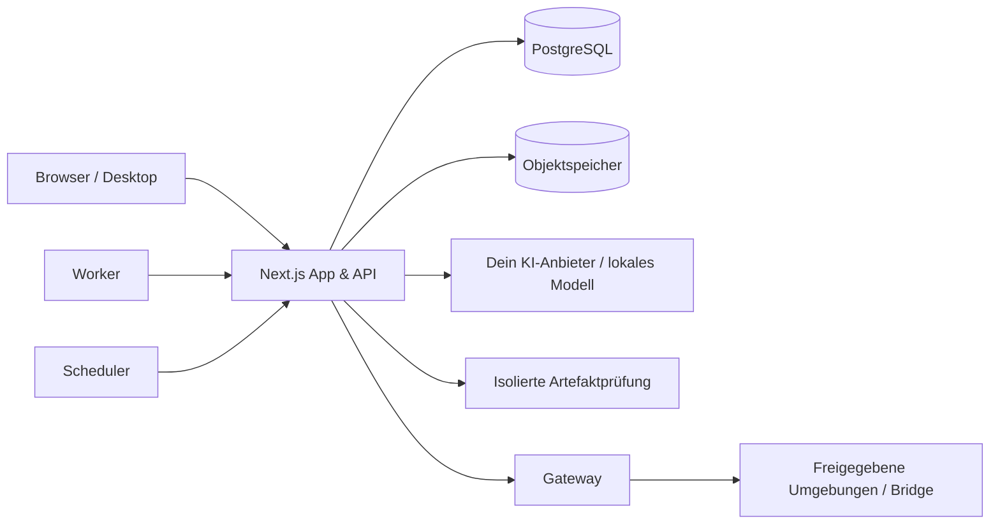

<p align="center"></p>

<p align="center"><strong>Ein Workspace für Agenten, echte Ergebnisse und Entscheidungen, die bei dir bleiben.</strong></p>
<p align="center">Lokal selbst betreiben · Eigene KI-Modelle · Projektgrenzen · Feste Budgets · Prüffähige Abläufe</p>
<p align="center"><a href="#in-wenigen-schritten-lokal-starten">Schnellstart</a> · <a href="#so-sieht-kerncloud-aus">Einblicke</a> · <a href="#desktop-apps">Desktop</a> · <a href="docs/SELF-HOSTING.md">Anleitung</a> · <a href="README.en.md">English</a> · <a href="LICENSE">Lizenz</a></p>

---

## Von „Mach mal“ zu nachvollziehbarer Arbeit

KeRnCloud bringt KI-Agenten in einen gemeinsamen Arbeitsbereich. Du beschreibst ein Ziel, dein Team verteilt Aufgaben, nutzt freigegebene Werkzeuge und liefert Dateien, Vorschauen und einen überprüfbaren Arbeitsverlauf. Rückfragen, fehlende Zugänge und Freigaben landen zentral im Postfach.

**Du bestimmst, welches Modell arbeitet, worauf es zugreifen darf und wie viel es verbrauchen darf.** Die Plattform läuft auf deinem eigenen Rechner oder Server. Eigene Modellserver und API-Zugänge werden unterstützt; ein Modell und dessen Kosten sind nicht im lokalen Softwarezugang enthalten.

> **Source available, nicht Open Source:** private und interne geschäftliche Nutzung sind ohne KeRnCloud-Abo erlaubt. Kostenlos veröffentlichte Forks müssen Quellcode und dieselben Bedingungen enthalten. Weiterverkauf und kostenpflichtiges Hosting durch Dritte benötigen eine schriftliche kommerzielle Erlaubnis von KeRn-WS. [Lizenz im Klartext](docs/LICENSING.md).

## So sieht KeRnCloud aus

Die Bilder zeigen die echte Anwendung mit **neutralen Beispieldaten**. Sie sind keine Kundenergebnisse oder Leistungsversprechen. Die aktuellen Oberflächen unterstützen Deutsch, Englisch sowie Hell-, Dunkel- und Systemdarstellung.

<p align="center"></p>
<p align="center"><sub>Ein Einstieg: Was läuft, was ist fertig und wo braucht dich dein Team?</sub></p>

<table><tr><td width="50%"><br><strong>Projekte statt Dateichaos</strong><br>Dateien, Wissen, Aufträge und Umgebungen haben eine sichtbare Zuordnung.</td><td width="50%"><br><strong>Entscheidungen an einem Ort</strong><br>Aktion, Ziel und Budget prüfen, freigeben, ablehnen oder Informationen ergänzen.</td></tr><tr><td><br><strong>Dein Agententeam</strong><br>Rollen, Hierarchie, Werkzeuge, Übergaben und tatsächliche Arbeitsschritte nachvollziehen.</td><td><br><strong>Plan und Verlauf</strong><br>Geplante Schritte, Abhängigkeiten und tatsächliche Ausführung vergleichen.</td></tr></table>

## Was du damit machen kannst

| Du möchtest … | KeRnCloud verbindet dafür … |
| --- | --- |
| Eine Website oder ein Dateipaket erstellen lassen | Auftrag, freigegebene Ausführungsumgebung, Artefakte, isolierte Vorschau und ZIP-Download |
| Ein Projekt über mehrere Aufträge entwickeln | Projektdateien, Gedächtnis, Teamchat und explizite Freigabe gemeinsamer Materialien |
| Mehrere Agenten zusammenarbeiten lassen | Rollen, Delegation, Übergaben und Organisationsstruktur |
| Bei Problemen eingreifen können | Entscheidungs-Postfach, Rückfragen, Pause und nachvollziehbare Werkzeugevents |
| Kosten kontrollieren | Token- und Credit-Limits, Verbrauchserfassung und zugelassene Fallback-Modelle |
| Wiederkehrende Arbeit standardisieren | Prüffähige Skills, Routinen, Planung und gespeicherte Arbeitsstände |
| Lokale Daten gezielt zugänglich machen | Separater Bridge-Adapter mit Projekten, Agenten und lokal erteilten Rechten |
| Andere Systeme verbinden | Modellkataloge, eigene API-Zugänge, verbundene Dienste und freigegebene MCP-Werkzeuge |

Die Plattform protokolliert Pläne, Aktionen, Ergebnisse und Übergaben. Sie behauptet nicht, private interne Denkprozesse eines Modells sichtbar zu machen. Autonomie bedeutet hier Arbeit innerhalb der eingeräumten Rechte und Budgets; fehlende Freigaben und unklare externe Effekte dürfen weiterhin eine Rückfrage erfordern.

## In wenigen Schritten lokal starten

**Du brauchst:** Docker Desktop mit Linux-Containern (Windows/macOS) oder Docker Engine mit Compose v2 (Linux) sowie **Node.js 22+**. Als Startgröße 4 CPU-Kerne, 8 GB freier RAM und 20 GB freier Speicher einplanen. Browser, Builds und lokale KI-Modelle können mehr benötigen.

Repository herunterladen/klonen, entpacken und im Projektordner ausführen:

```sh
node scripts/self-host.mjs init
node scripts/self-host.mjs doctor
node scripts/self-host.mjs start
```

**Dann [localhost:3100/login](http://localhost:3100/login) öffnen.** Der erste Start baut die Images und benötigt Internet. Ein Host-`npm install` ist für diesen Weg nicht nötig.

1. E-Mail und zufälliges Passwort aus der lokalen `.env` verwenden (`ADMIN_EMAIL`, `ADMIN_PASSWORD`).
2. Nach der ersten Anmeldung das Administratorpasswort ändern.
3. Unter **Verbindungen & Umgebungen → KI-Modelle** einen eigenen Anbieter oder lokalen Modellserver hinzufügen.
4. Projekt anlegen, Budget setzen und einen kleinen Auftrag starten.

Windows bietet zusätzlich `start-local.cmd`; unter Linux/macOS geht `sh start-local.sh`. Bei belegten Ports vor der ersten Einrichtung beispielsweise `init --port 4100 --gateway-port 4200` verwenden. Wiederholtes Starten behält vorhandene Schlüssel und Daten. Öffentliche Registrierung ist auf der privaten Installation zunächst deaktiviert.

**Ein Beispielauftrag:** „Erstelle eine kleine responsive Landingpage mit FAQ. Liefere HTML-Dateien und eine Vorschau, teste die Interaktionen und bleibe innerhalb des festgelegten Tokenlimits.“ Ein Ergebnis hängt vom eingerichteten Modell und den verfügbaren Werkzeugen ab; ohne Modell werden keine KI-Leistungen simuliert.

→ [Vollständige lokale Anleitung](docs/SELF-HOSTING.md) · [Lokale Connectoren und Umgebungen](docs/CUSTOMER-HOSTS.md)

## Selbst betreiben oder Betrieb buchen

| | Self-hosted | KeRnCloud als gehosteter Service |
| --- | --- | --- |
| Wo läuft es? | Auf deinem Rechner/Server | Auf Infrastruktur von KeRn-WS |
| Wofür zahlst du? | Eigene Hardware und ggf. KI-Anbieter; optional Einrichtung/Support | Hosting, Betrieb, Support, tarifabhängige Laufzeit; ggf. Betreiber-KI |
| Modelle | Eigene API-Zugänge oder eigener Modellserver | Eigene Zugänge oder separat berechnete Betreiber-Modelle |
| Daten, Backups, Updates | Deine Verantwortung, mit lokalen Werkzeugen | Teil des vereinbarten Betriebsangebots |
| Softwarezugang | Ohne KeRnCloud-Abo im erlaubten Lizenzrahmen | Nach vereinbartem Tarif |

Dieses Release ist kein Kaufabschluss und bestätigt keine produktive Zahlungsanbindung. Cloud-Preise werden administrativ gepflegt; ein öffentliches Angebot muss vorher kalkuliert und freigegeben werden. Kontakt für Betrieb, Support oder kommerzielle Sonderrechte: **support@kern-ws.com**.

## Desktop-Apps

Der Quellcode enthält eine eigene Desktop-App als Einstieg in die lokale Plattform:

| System | Paketformat | Funktion |
| --- | --- | --- |
| Windows x64 | Setup `.exe` | Installation, Verknüpfungen, lokaler Start, Dashboard-Fenster |
| Linux x64/arm64 | `.AppImage`, `.deb` | Lokaler Start und Dashboard-Fenster |
| macOS Intel / Apple Silicon | `.dmg`, `.zip` | App-Installation, lokaler Start und Dashboard-Fenster |

Docker bleibt erforderlich. Desktop ist der Launcher und Client; PostgreSQL, Worker und Sandboxes laufen weiterhin als getrennte Dienste. Die vorhandene **Bridge** ist ein anderer Client für gezielt freigegebenen Gerätezugriff.

```sh
node scripts/desktop-payload.mjs
cd desktop-app
npm ci
node node_modules/electron/install.js
npm test
npm start
# Installer auf dem jeweiligen Zielsystem bauen:
npm run build
```

Ein manueller CI-Workflow ist für alle drei Systeme vorbereitet. Es gibt bewusst keine Download-Buttons zu noch nicht freigegebenen Releases. Signierung, Notarisierung und native Tests werden pro Release nachgewiesen. [Desktop-Builds und Signierung](docs/DESKTOP.md).

## Betrieb ohne Überraschungen

```sh
node scripts/self-host.mjs status  # Dienste anzeigen
node scripts/self-host.mjs logs    # Letzte App-/Worker-Meldungen
node scripts/self-host.mjs backup  # Datenbank + Objektspeicher sichern
node scripts/self-host.mjs stop    # Dienste stoppen, Daten behalten
node scripts/self-host.mjs update  # Erst Backup, dann Build/Neustart
```

Updates verwenden den bereits heruntergeladenen freigegebenen Quellstand. `.env`, Datenbank und Datei-Volumes bleiben erhalten. Offene Aufträge blockieren den Update-Neustart. **Niemals `docker compose down -v` für ein normales Update verwenden.** Den passenden Verschlüsselungsschlüssel zusätzlich zum Backup sicher verwahren.

## Wie es aufgebaut ist



- **Next.js / React / TypeScript** für Dashboard und serverseitige API.
- **PostgreSQL** für Konten, Projektgrenzen, Aufträge, Leases und Verbrauch.
- **HTTP-Worker und Scheduler** für dauerhafte, getrennte Ausführung.
- **Objektspeicher, Gateway und Validator** als getrennte Dienste.
- **Docker Compose** für den lokalen Einstieg; zusätzliche Infrastruktur-Connectoren sind optional.

Die Standardinstallation veröffentlicht nur Loopback-Ports. Es gibt keinen Docker-Socket im Dashboard, in Agentenworkern oder in Kundencode. Vertrauenswürdige Betreiber-Connectoren sind separat und ausdrücklich einzurichten. Mehrere Worker sind möglich; eine Aussage wie „100.000 Nutzer getestet“ wäre ohne passende Last- und Betriebsnachweise falsch.

## Entwickeln und prüfen

```sh
npm ci
npm run typecheck
npm test
npm run test:local
npm run build
npm run release:check
```

Integrationstests ausschließlich in einer getrennten Datenbank mit Endung `_test` ausführen. Der Release-Check prüft Dateiausschlüsse, auffällige Geheimnisse, Dokumentationslinks und Veröffentlichungsdateien; er ersetzt keine vollständige Sicherheits- oder Rechteprüfung. Das Repository enthält keine produktive `.env`, Backups, Kundendaten, privaten Signierschlüssel oder alte Git-Historie.

## Dokumentation

| Einstieg & Betrieb | Produkt & Erweiterung |
| --- | --- |
| [Self-hosting](docs/SELF-HOSTING.md) | [Agenten-Arbeitsprotokoll](docs/AGENT-INSPECTOR.md) |
| [Desktop und Installer](docs/DESKTOP.md) | [Projekte und Timeline](docs/TIMELINE-AND-PROJECTS.md) |
| [Betriebsanforderungen](docs/OPERATIONS.md) | [Organisation](docs/ORGANISATION.md) |
| [Veröffentlichungscheckliste](docs/PUBLISHING.md) | [Bridge und Gerätezugriff](docs/BRIDGE.md) |
| [Lizenz](docs/LICENSING.md) | [Geschäftsmodell](docs/BUSINESS-MODEL.md) |
| [Sicherheitsmeldungen](SECURITY.md) | [Beiträge](CONTRIBUTING.md) |

## Grenzen und Verantwortung

KI kann Fehler machen. Feste Tokenlimits sind keine Garantie für einen exakt gleichen Geldbetrag bei jedem externen Anbieter. Unsicherer Verbrauch und unklare externe Effekte werden konservativ behandelt. Lokale Modelle brauchen ausreichende Hardware und passende Werkzeugunterstützung. Die Installation ist kein pauschaler Nachweis für Datenschutzkonformität, vollständige Sandbox-Isolation oder produktive Hochverfügbarkeit.

Ältere thematische Dokumente beschreiben auch die SaaS-Entwicklung; für den neuen lokalen Einstieg haben diese README und `docs/SELF-HOSTING.md` Vorrang. Der konkrete Teststand eines Builds gehört in dessen Prüfbericht.

---

**KeRnCloud von KeRn-WS** · [kern-ws.com](https://kern-ws.com) · [support@kern-ws.com](mailto:support@kern-ws.com)

Copyright © 2026 KeRn-WS. [KeRnCloud Source Available License 1.0](LICENSE). Drittanbieter behalten ihre eigenen Lizenzen: [THIRD_PARTY_NOTICES.md](THIRD_PARTY_NOTICES.md).
