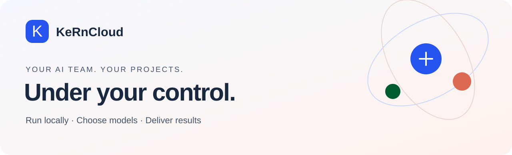

<p align="center"></p>

# KeRnCloud

**A local workspace for AI agents, real deliverables and decisions you control.**

[GitHub](https://github.com/xKeRnx/kerncloud-self-hosted) · [Deutsch](README.de.md) · [Self-hosting guide](docs/SELF-HOSTING.md) · [Desktop](docs/DESKTOP.md) · [License](LICENSE)

Bring agents, project files, memory, models and approvals into one place. Describe a goal, assign roles, follow tool activity and handoffs, and review files with isolated previews and ZIP downloads. Each task keeps its fixed token/credit limits. Model quality and available tools determine the result.


## Run locally

Install Docker Desktop (Windows/macOS, Linux containers) or Docker Engine with Compose v2 (Linux), plus Node.js 22+. Start with 4 CPU cores, 8 GB free RAM and 20 GB disk; browser sandboxes, image builds and local models may require more.

Clone the public self-hosted repository and run from its root:

```sh
git clone https://github.com/xKeRnx/kerncloud-self-hosted.git
cd kerncloud-self-hosted
node scripts/self-host.mjs init
node scripts/self-host.mjs doctor
node scripts/self-host.mjs start
```

Open http://localhost:3100/login. The first start downloads the version-pinned release images and needs internet. A source checkout without an image manifest builds locally instead. Your generated administrator email and password are stored in the private `.env` file; change the password after signing in. Connect your own model in the dashboard, create a project, set a task budget and start a small job. No AI calls are simulated when a model is missing.

You do not need `npm install` on the host for this source quick start. Windows also has `start-local.cmd`; Linux/macOS have `sh start-local.sh`. Before the first start, choose different ports with `init --port 4100 --gateway-port 4200` if needed. Existing configuration is preserved. Public registration is disabled by default.

## What is included

| Capability | Purpose |
| --- | --- |
| Projects and memory | Keep tasks, files and knowledge scoped, with explicit sharing |
| Agent teams | Roles, delegation, organizational hierarchy and tool activity |
| Decision inbox | Review actions, costs and targets; approve, reject or add information |
| Deliverables | Files, previews and ZIP downloads |
| Budget controls | Task limits, usage accounting and approved fallback models |
| Skills and routines | Reusable reviewed workflows and scheduled work |
| Bridge / connectors | Deliberately authorized device and environment access |
| Models / MCP | Chat Completions, Responses and Anthropic Messages adapters, local models and approved tools |
| Integrations | Searchable service gallery, OAuth or encrypted provider tokens, project/agent grants and read-only connection tests |
| Work modes | Draft, single-agent execution or a team sharing one fixed budget |
| Task workplace | See environment activity, pause and take control, then hand back |
| Project pages | Versioned reports and dashboards with reviewed, expiring sharing links |
| Starter teams | Reviewable Website studio, Research desk and Office assistant templates |

<table><tr><td><br>Project boundaries</td><td><br>Central approvals</td></tr><tr><td><br>Agent activity</td><td><br>Plans and execution</td></tr></table>

Screenshots show the real application with neutral demonstration data. They are not customer testimonials or performance guarantees. Plans, actions and results are observable; private internal model reasoning is not an execution log.

See [workflows and safety boundaries](docs/WORKFLOWS.md) for the new modes, engines, workplace, pages and team templates.
See [the full integration catalog and setup guide](docs/INTEGRATIONS.md) for supported services, exact capabilities, social media, data providers and further integration ideas.

## Self-hosting and the business model

Self-hosting requires no KeRnCloud subscription or license server for permitted use. You pay for your hardware and any external model provider you choose. KeRn-WS may charge separately for setup, support and managed hosting. Existing cloud billing remains separate; this repository does not promise a live checkout, hosting price or included model allowance.

The local server grants new accounts a free self-hosted plan. It preserves resource limits, task budgets, permissions and sandbox controls. It does not convert existing SaaS accounts or balances. The default exposes only loopback ports. Docker access is reserved for separately configured trusted operator connectors.

## Desktop

The separate desktop launcher can run the Docker stack on this computer **or connect to an existing KeRnCloud server**. Server-client mode requires no local Docker service. It opens an isolated dashboard window. Build targets: Windows NSIS `.exe`, Linux `.AppImage`/`.deb`, macOS `.dmg`/`.zip`. Docker is required on the machine hosting the server. Database volumes, configuration and access permissions live outside the application package.

Desktop 0.38.3 and newer automatically check for verified app updates and can install them directly in the launcher. Your local data and permissions are preserved. See [desktop updates](docs/DESKTOP.md#update-and-uninstall).

```sh
node scripts/desktop-payload.mjs
cd desktop-app
npm ci
node node_modules/electron/install.js
npm test
npm start
npm run build
```

Build on the appropriate platform. The manual CI workflow prepares each platform separately; signing/notarization requires your accounts and certificates. Actual platform verification belongs in each release report. No nonexistent release download links are advertised. The Bridge adapter is separate from the desktop launcher.

## Maintenance

```sh
node scripts/self-host.mjs status
node scripts/self-host.mjs backup
node scripts/self-host.mjs stop
node scripts/self-host.mjs update
```

Stop preserves volumes. Update uses your downloaded source version, refuses to restart while tasks remain open, and takes a backup first. Preserve the matching `.env`/encryption key separately. Never use `down -v` for a normal update. Database and object backups are separate snapshots; pause work for consistency. Restore into a separate installation before relying on a backup.

## Develop

```sh
npm ci
npm run typecheck
npm test
npm run test:local
npm run build
npm run release:check
```

Integration tests must target a separate database ending in `_test`. The architecture uses Next.js/React/TypeScript, PostgreSQL, HTTP workers, scheduler, object storage, gateway and artifact validator. Local deployment is not a blanket guarantee of compliance, sandbox security, production readiness or capacity.

## License

**Source available, not OSI open source.** The custom license permits personal and internal business use. Free redistributions must include corresponding source under the same terms. Paid resale, paid hosting and white-label derivatives need prior written commercial permission from KeRn-WS. Independent outputs may be sold. Private internal modifications do not need publication. Third-party licenses are unaffected. Read [LICENSE](LICENSE), [licensing notes](docs/LICENSING.md) and [third-party notices](THIRD_PARTY_NOTICES.md).

External contributions to the commercial product require a separate written contributor agreement. Review the [publishing checklist](docs/PUBLISHING.md) before making this repository public.

KeRn-WS · https://kern-ws.com · support@kern-ws.com
