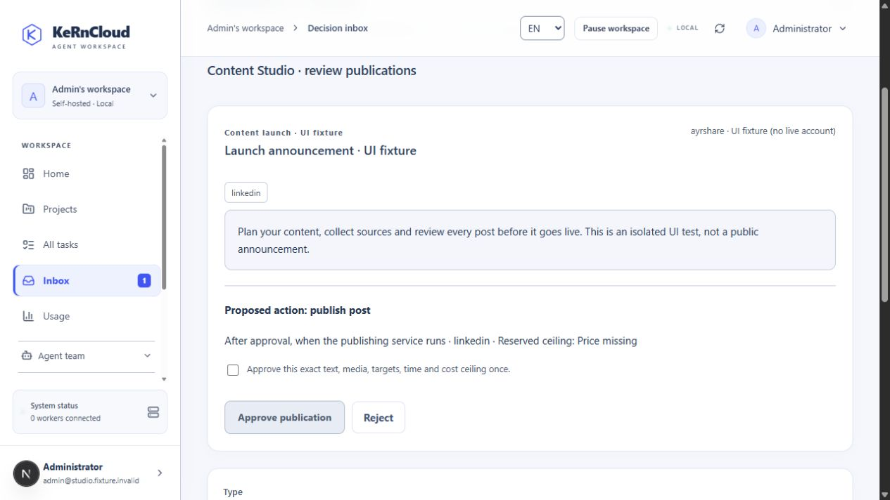
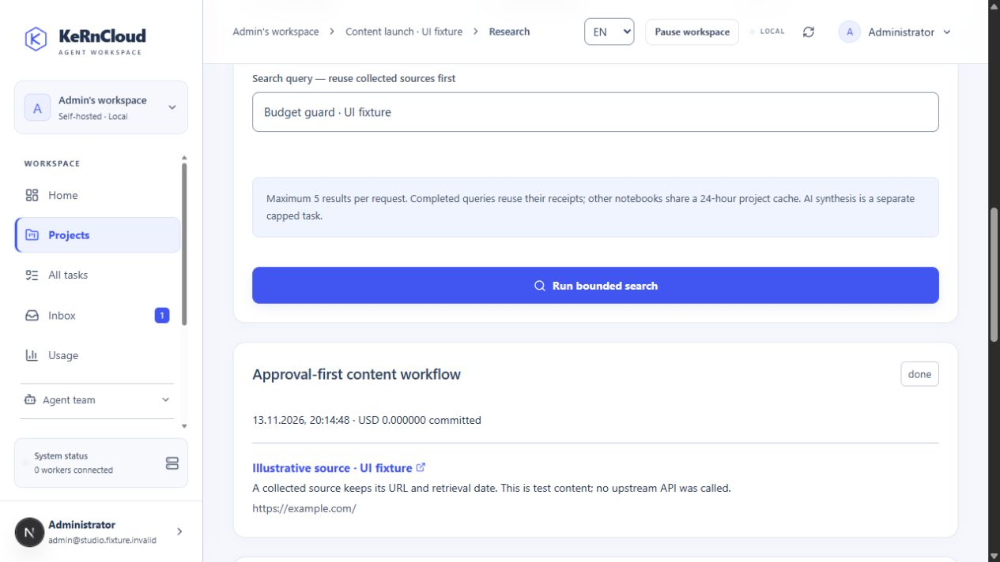

# Content Studio and Research

Open **Projects → a project → Content Studio / Research**. Both areas retain the selected project's boundaries and use the existing integrations, tasks and permissions.

The screenshots use isolated UI fixtures, without live social accounts or paid searches.

## Fixed limits first

Expand **Fixed external project limits**. New budgets start at zero. Set a lifetime USD ceiling and total provider-request limit. Each research notebook also has its own fixed USD/request limits (at most 20 requests).

Confirm the maximum total price per API request for each connection, including all platform/media/plan fees. Confirmations expire within 31 days. Unknown or expired prices block dispatch. The server commits that maximum atomically before a request; errors and uncertain outcomes retain the reservation.

These records describe **committed ceilings, not actual provider invoices**. KeRnCloud enforces request/reservation limits, not third-party billing. The USD estimate relies on your confirmed provider maximum; also configure provider-side hard spending caps. A changed or incorrectly entered price can invalidate the real-world estimate. AI tokens and credits remain separate and use existing fixed task/project limits. No billable endpoint is called automatically to guess prices or test credentials.

## Content Studio

1. Connect Ayrshare under Integrations, allow the project and enable writes on the intended publishing connection. Link social accounts in Ayrshare. Its plan/account requirements apply.
2. Prepare text, up to five target platforms, up to four public HTTPS media URLs and an optional dispatch time in UTC (at most 30 days ahead). Private files are not uploaded automatically.
3. Save a private draft and request review. The request appears in the project and central Inbox.
4. An owner/admin approves the exact revision, text, media, targets, time, connection and displayed cost ceiling. Editing a draft, replacing the token or changing price/project policy invalidates approval.
5. The dedicated publisher claims due, approved posts without an AI call. Paused projects/workspaces, suspended/expired accounts and exhausted limits block dispatch.

**Submitted** means Ayrshare accepted the request, not that each network has finally published it. Inspect provider receipts/history for delivery. Platform-specific media/account requirements apply. Partial failures and interrupted/uncertain writes require review and are never automatically retried. Create a new reviewed draft only after inspecting the provider; original dispatch records remain unchanged.

Agents use `save_content_draft` with `request_review=true`, then finish without waiting for publication. They cannot approve. Generic Ayrshare writes through `app_action` are blocked in favor of Studio review and budgets.

## Research

Connect Tavily, Brave Search or Exa and grant the project/agents access. Create a notebook with fixed limits. Search returns at most five results: Tavily basic with automatic parameters, AI answers and raw content disabled; Exa lite with bounded highlights; Brave bounded web search. Crawling, extraction add-ons and paid scraper launches are not enabled.

Results retain source URLs, excerpts and retrieval dates. They are untrusted source claims, not independently verified facts. A notebook reuses completed query receipts. Other notebooks in the same project can reuse matching connection-revision/query results for 24 hours at no additional provider call, retaining the original retrieval date. Uncertain queries do not retry automatically. Concurrent requests cannot exceed notebook/project limits.

Agents receive a compact index and load one query's excerpts at a time. Full sources and reports remain in the UI/export. Save a Markdown report with citations and uncertainty, download it with collected references, or restore a previous report as a new revision. Stale writes fail instead of overwriting newer revisions.

AI assistance starts a normal task with explicit maximum total tokens and credits. Post preparation and source-only synthesis use draft mode. Autonomous research uses single-agent execution and the existing notebook's external limits; it cannot raise budgets. Missing models, grants, prices or budgets produce errors rather than simulated success.

## Operations and verification

`npm run local:start` includes the publisher. Operators can scale `publisher` using the installation's normal Compose project/environment. `PUBLISHER_CONCURRENCY` is bounded from 1 to 16 per instance. Row claims use `FOR UPDATE SKIP LOCKED` and dispatch tokens; there is no global singleton sender. The service has no Docker socket or customer-code execution permission. The scheduler marks interrupted claims uncertain and never resubmits them.

Backups include drafts, versions, sources, reports and cost receipts. The migration adds structures without replacing existing tables/credentials. Protocol/database fixtures cover zero/unknown budgets, concurrency, caching, project/role isolation, stale prices, changed connections, edited drafts, once-only dispatch and uncertain outcomes. Live account checks require the owner's configured services and explicit publication approval.

This release starts the requested rollout with Content Studio and Research. Social inboxes, delivery analytics, further CRM/shop adapters and optional managed connector platforms remain separate expansion work.
